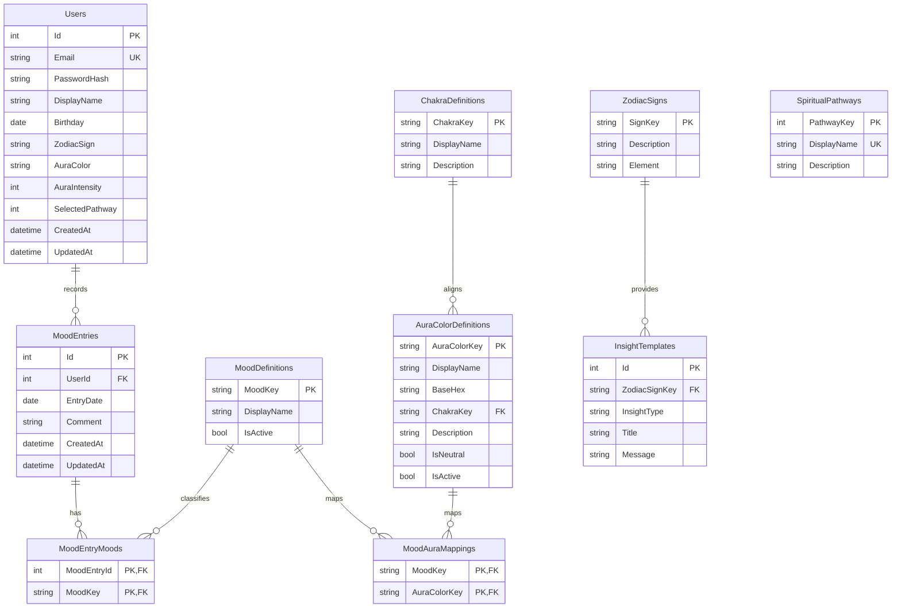

# Aura Logbook relational ERD

The UI shade palette remains presentation-only. `BaseHex` stores the canonical
MUI 500 value used by the reference data; the UI continues to derive intensity
shades from its existing palette.
