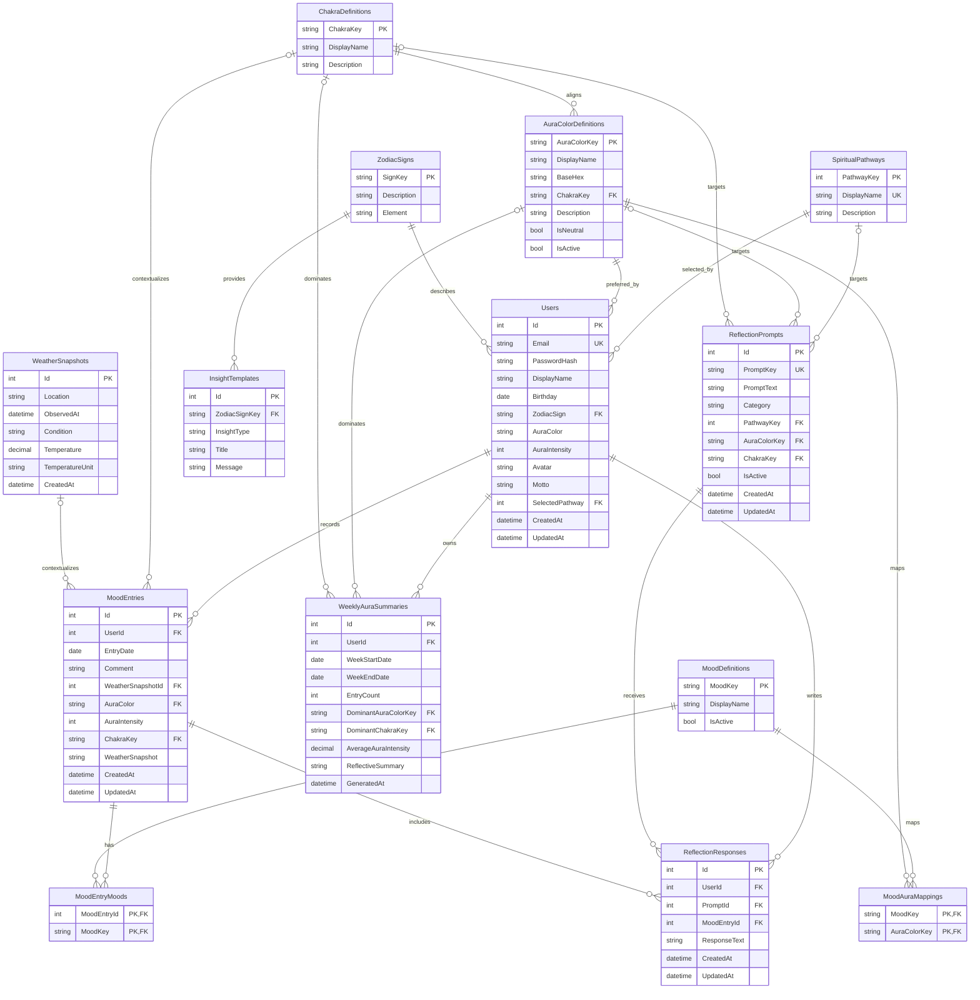

# Aura Logbook relational ERD

This diagram reflects the schema produced by the current SQL migrations under `AuraLogbook.Api/Data/Database/Migrations/`. Development and FIT/Staging use this SQLite schema. Some tables are schema foundations for features that are not yet complete in the UI; a table's presence is not evidence that its end-user experience is finished.

## Current boundaries

- `BaseHex` is canonical reference data; the UI can derive accessible presentation shades from it.
- `MoodEntries.WeatherSnapshotId` references the normalized weather table. `MoodEntries.WeatherSnapshot` is a later text context field and should not be assumed to contain the same shape.
- `MoodEntries.AuraColor` is currently contextual text rather than a declared foreign key; validate it at the application boundary until a forward migration adds a database constraint.
- Reflection responses are owned by a user and tied to both a prompt and one of that user's mood entries. The API enforces that ownership relationship.
- Weekly summaries are unique by the composite `(UserId, WeekStartDate)` key.
- Weekly aura summary and weather snapshot tables exist in migrations, but their complete generation, persistence, and UI journeys must be verified separately before being described as shipped features.
- Migration history is authoritative. Do not edit an already-applied migration to make this diagram match; add a reviewed forward migration and update the diagram.
