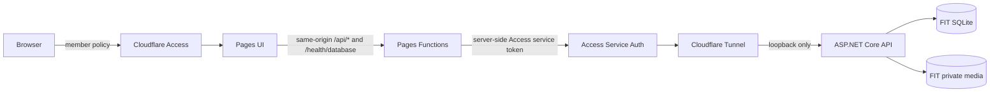

# Cloudflare FIT hosting

This document defines the Cloudflare deployment path for Aura Logbook's web
FIT environment. The repository implementation includes Pages Functions for
the same-origin API proxy and database readiness probe. Cloudflare Pages,
Access, Tunnel, host, and DNS configuration still requires owner-controlled
Cloudflare account access; a repository build alone does not establish a live
deployment.

## Deployment boundary

Cloudflare Pages serves the React/Vite web app and its Pages Functions. The
.NET API remains a separate process on an owner-controlled, always-on host.
Cloudflare Tunnel gives that loopback API an outbound route, while Cloudflare
Access requires the Pages Function's server-side service identity to reach it.
Aura's JWT authentication and user-scoped authorization remain in place.

Tunnel supplies connectivity, not compute or persistent storage. If the API
host sleeps, loses power or network, or its API/connector stops, the UI can
remain available while API calls fail. Run one API process for SQLite's
single-writer model. Keep the FIT database and private media together on
durable storage and back them up as one recovery set.

## Pages project settings

Keep the repository root as the Pages project root so the root-level
`functions/` directory is included. Use the Vite app as the build target:

| Setting | FIT value |
| --- | --- |
| Framework preset | None / custom |
| Root directory | Repository root |
| Build command | `npm ci --prefix aura-ui && npm run build --prefix aura-ui` |
| Build output directory | `aura-ui/dist` |
| Build variable `VITE_API_BASE_URL` | `/api` |

Configure the same-origin proxy's runtime bindings in the Cloudflare Pages
project. Set `API_TUNNEL_URL` to the verified HTTPS API origin as a non-secret
Function variable. Set `ACCESS_SERVICE_TOKEN_CLIENT_ID` and
`ACCESS_SERVICE_TOKEN_CLIENT_SECRET` as encrypted Function secrets. Configure
each needed Preview/FIT environment separately. Never put Access credentials
in a `VITE_*` value, static asset, `.env` committed to Git, or browser storage.

For local Pages Function development, use Wrangler's ignored `.dev.vars` file
at the repository root with synthetic/non-production values only. Never commit
this file. The current repo does not commit a Wrangler deployment manifest:
the actual Pages project's Git settings and bindings must be inspected before
choosing a manifest, to avoid configuration drift or duplicate bindings.

## Pages Function routes

- `functions/api/[[path]].ts` forwards Aura `/api/*` calls to the fixed
  `API_TUNNEL_URL`, preserving method, path, query, body, and Aura bearer token.
- `functions/health/database.ts` forwards only GET/HEAD to the API's
  `/health/database` route so deployment smoke checks can stay behind Access.
- Both routes discard caller-provided Cloudflare service-token headers and
  attach the configured server-side credentials. They return generic safe
  failures and do not log request/response content or credentials.
- API-origin redirects are routed back through the Pages origin; redirects to
  external providers (for example Spotify authorization) are preserved.
- Keep provider callbacks on the same-origin `/api/...` route so the Function
  supplies the Access identity before the API handles the callback.

The API origin is configured as an HTTPS origin only. Do not allow a request
parameter or header to select an upstream host. Cloudflare Access service
authentication proves that the Pages Function can reach the API; it does not
replace Aura login or authorize access to another user's records.

## API host and data

1. Select an owner-controlled host that can stay awake and connected. Install
   the supported .NET runtime and `cloudflared`; run both API and connector as
   restartable host-managed services.
2. Bind the API to loopback (normally `127.0.0.1:5082`) and do not open an
   inbound firewall port. Use ASP.NET `Staging` (`AURA_ENV=FIT`) with startup
   user seeding disabled.
3. Set `Database__ConnectionString` to a durable FIT-only SQLite file and
   `Storage__PrivateMediaPath` to a durable private directory outside
   `wwwroot`. Keep both separate from Development and Production.
4. Keep `Jwt__Key`, OAuth/provider credentials, and any SMTP credentials in
   the host's protected configuration store. Use separate FIT credentials and
   callback URLs. Do not copy Production records or media into FIT.
5. Create a named Tunnel route for the verified API hostname to the loopback
   API. Protect that hostname with an Access Service Auth policy that allows
   only the Pages FIT service token. The UI member policy is separate.
6. Confirm the Access boundary denies a request without the intended service
   identity and accepts the Pages Function. Do not expose the API publicly to
   satisfy a health check.

As of the current repo baseline, the API targets .NET 9. Verify the current
runtime support policy before exposing FIT publicly; use the supported-runtime
upgrade work as a prerequisite where needed. Do not silently expose an
unsupported runtime.

## FIT data and test clients

FIT/Staging already has a separate local database (`Data/auralogbook-fit.db`)
and startup user seeding disabled. Hosted FIT must override the local path with
durable storage. Use only the synthetic FIT identities and records tracked in
[issue #475](https://github.com/GemsForge/aura-logbook-api/issues/475); never
use real client details or Production records. The developer toolbar is a
separate development-only helper in issues #479, #484, and #485. It must not
be bundled as a Production control surface.

## Verification and rollback

Before calling FIT hosting verified, capture evidence that:

- Pages deployed the intended commit and compiled the Pages Functions.
- The UI member policy and API Service Auth policy allow/deny the intended
  identities.
- The Pages Function reaches the API through Access and Tunnel, and direct
  access without the intended service identity is denied.
- Aura login, reference data, a synthetic-user-owned read/write/delete flow,
  media upload/download, and configured provider callbacks work.
- `GET /health/database` returns healthy through the Pages route.
- FIT database and private media survive API restart and host reboot.
- Build output, browser assets, and logs contain no service credentials, JWTs,
  journal text, or private photos.

Restore UI from a known-good Pages deployment and API code from a retained
artifact independently. Treat data recovery separately: take a backup first
and use [database recovery](../database-recovery.md). Do not delete or restore
over Production data as a first response.

## Current issues

- [#477 FIT API host, Tunnel, and data boundary](https://github.com/GemsForge/aura-logbook-api/issues/477)
- [#478 Pages UI and same-origin proxy](https://github.com/GemsForge/aura-logbook-api/issues/478)
- [#479 developer console toolbar](https://github.com/GemsForge/aura-logbook-api/issues/479)
- [#483 Pages API proxy](https://github.com/GemsForge/aura-logbook-api/issues/483)
- [#484 local API lifecycle controls](https://github.com/GemsForge/aura-logbook-api/issues/484)
- [#485 synthetic client selector](https://github.com/GemsForge/aura-logbook-api/issues/485)

See [Cloudflare Pages build settings](https://developers.cloudflare.com/pages/configuration/build-configuration/), [Pages Functions routing](https://developers.cloudflare.com/pages/functions/routing/), [Pages bindings and secrets](https://developers.cloudflare.com/pages/functions/bindings/), [Cloudflare Tunnel](https://developers.cloudflare.com/cloudflare-one/networks/connectivity-options/), and [Access service tokens](https://developers.cloudflare.com/cloudflare-one/access-controls/service-credentials/service-tokens/) for current provider instructions.
