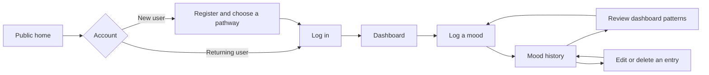
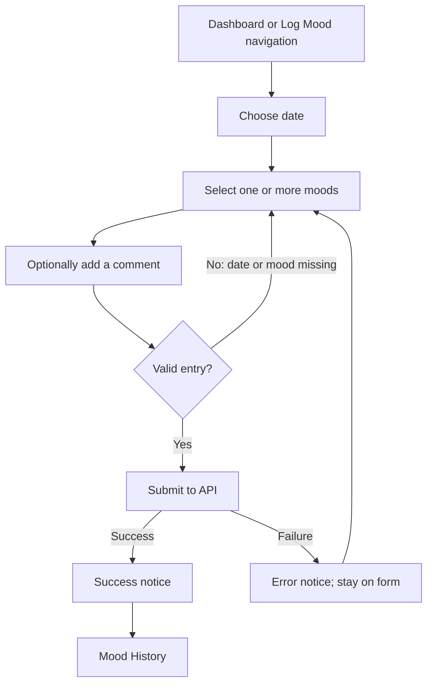

# Aura Logbook core user journeys

This map records the experience implemented in the current web app and separates it from the intended direction. It is a UX planning artifact for the Prism Garden dashboard work; it does not claim that every concept shown in the visual proposal already exists.

## Product-level path

Authenticated pages are protected: a signed-out visit to Dashboard, Log Mood, or Mood History redirects to Login. The public home CTA sends signed-out visitors to Login (registration is available in the top navigation) and signed-in users to Dashboard.

## Journey maps

### 1. First visit, account, and pathway

| Step | Current experience | Useful completion signal |
| --- | --- | --- |
| Discover | Public Home describes the product and offers “Start Your Aura Journey.” | User understands the product is for recording and exploring their own experience. |
| Create account | Register asks for email, password and confirmation, display name, birthday, and a pathway. Mindfulness is preselected; the current options are Mindfulness, Astrology & Energy, and Faith & Religion. | Validation is clear; registration success leads to Login. |
| Return | Login accepts email/password, hydrates the user session, then navigates to Dashboard. | Authenticated dashboard appears; session failure gives an error and leaves the user able to try again. |
| Personalize later | Profile card exposes Edit Profile, where pathway, aura preference, avatar, motto, and account details can be changed. | Saved preferences are reflected in the profile and theme. |

**Current boundary:** pathway selection is a profile preference and is displayed on the Dashboard. The current code does not yet use it to change mood entry, prompts, or insight content. The current pathway labels and descriptions also need review against the inclusive experience principles before redesign copy is treated as final.

### 2. Record a mood

The form defaults the date to today, groups mood choices by their associated aura color, shows color meanings in tooltips, requires at least one mood, and makes the comment optional. It currently does **not** ask the user to select an aura color/intensity directly, provide a reflection prompt, or save a separate prompt response. Selecting a mood within a color group is not the same as recording a user-selected aura.

### 3. Review and manage mood history

| Step | Current experience | Important state or gap |
| --- | --- | --- |
| Open history | Use the authenticated sidebar’s Mood History link. | Initial list request runs when the page opens. |
| Narrow results | Choose optional start/end dates and select Filter. Future dates are disallowed; end date cannot precede start date. | No visible loading indicator is defined for filtering. |
| Read an entry | Each card shows date, mood tags, and any comment. | The current empty result is a blank list below the filters; there is no explicit first-entry invitation. |
| Edit | Choose Edit, update date/moods/comment in a modal, then save. | Success refreshes the list; failure is reported by a toast. |
| Delete | Choose Delete, confirm in a dialog, then remove the entry. | Success refreshes the list; failure is reported by a toast. Deletion is irreversible in the current UI. |

### 4. Review patterns and decide what to do next

The current Dashboard’s displayed order is:

| Priority in current screen | Content | Purpose / data source |
| --- | --- | --- |
| Orientation | Time-based greeting and profile card/sidebar | Recognize the user and expose navigation, profile editing, and Log Mood. |
| Personal context | Selected pathway card and optional zodiac insight | Show the current pathway and profile-derived zodiac content. Zodiac content is not the same as a mood-derived reflection. |
| Overview | Total entries, most frequent mood, current streak, last-entry date | Quick summary from the authenticated mood dashboard endpoints. |
| Context | Current weather card | Supporting context; current page passes a fixed Atlanta location. It can independently show loading or “Unable to load weather.” |
| Trends | Mood Breakdown and Mood Entry Timeline | Mood frequency and entry counts by date; the timeline query requests the last 7 days. |

The user’s natural next action is to log a mood, but the current Dashboard does not give that action a prominent in-content call to action. Empty data falls back to zero/“N/A” values and empty charts; Last Entry shows “No entries yet.” The whole dashboard has a shared loading state for its primary queries. Errors for summary/chart/zodiac requests do not have dedicated page-level recovery messaging in the current component.

**Not currently implemented:** a weekly aura summary, aura history/intensity visualization, prompt library, response history, or a personalized interpretation derived from the user’s past entries. These should not be shown as live or data-driven features until implemented and verified.

## Cross-journey states to design for

| State | Current behavior | UX direction for the redesign |
| --- | --- | --- |
| Signed out | Protected routes redirect to Login. | Preserve the intended destination when practical; make registration easy to find. |
| Form validation | Inline messages identify invalid/missing values; API failures use toast notices. | Keep errors next to the field or action and explain how to recover. |
| Empty journal | Dashboard reports “No entries yet”; history has no explicit empty-state panel. | Offer one gentle, non-judgmental first-entry action; avoid implying the user is behind. |
| Network/service error | Weather has an inline error; mood form/history use toast notices; dashboard data errors may look like zero/empty values. | Distinguish “no data yet” from “could not load”; offer retry where appropriate. |
| Optional interpretation | Pathway and aura language appear in profile/dashboard and mood-color tooltips. | Keep core journaling usable without spiritual framing; make interpretations invitational and clearly optional. |
| Sensitive reflection | Comments are user-authored mood-entry text. | Keep ownership, privacy, and control visible; do not imply entries are public or analyzed unless true. |

## Dashboard hierarchy for the next concept

Recommended order for design exploration—not a claim about current implementation:

1. **Arrive and orient:** a warm greeting with a small, clear “Log a mood” action.
2. **Reflect now:** mood check-in and optional user-authored note; pathway language remains optional.
3. **Notice patterns:** a compact, honest summary and one legible trend visualization based only on recorded data.
4. **Supporting context:** weather and zodiac/pathway content are secondary, skippable, and never presented as causes of a mood.
5. **Return to the journal:** recent entries with a route to full history.

The next design story (#217) can turn this hierarchy into the profile-ready dashboard concept. Responsive/accessibility decisions belong to #218, and platform adaptation to #219.

## Open UX questions and assumptions

- Should choosing a pathway remain part of account creation, or should users be able to skip it and select one later? The current form requires a pathway and defaults to Mindfulness.
- Should the primary check-in record the user’s aura color/intensity directly, or only the selected mood(s) and their mapped color association? These are distinct data semantics.
- What does a “current streak” mean when users can backdate entries? Confirm the rule before giving it prominent motivational weight.
- Should weather be personalized to a user-selected location, hidden, or opt-in? The current Dashboard uses Atlanta as a fixed location.
- What should be shown when one dashboard service fails while others succeed? Current loading/error behavior is inconsistent across widgets.
- What is the first-entry and no-results history experience? Both should invite without pressure.
- What language should replace current “Astrology & Energy” and “Faith & Religion” labels to match the agreed Aura, Mindfulness, and user-defined Faith/Spirituality pathways?

## Evidence and verification

This map was checked against the current route definitions, screen/components, API calls, and UI tests:

- [`router.tsx`](../../aura-ui/src/router.tsx) and [`ProtectedRoute.tsx`](../../aura-ui/src/routes/ProtectedRoute.tsx)
- [`Home.tsx`](../../aura-ui/src/pages/Home.tsx), [`Register.tsx`](../../aura-ui/src/pages/Register.tsx), and [`Login.tsx`](../../aura-ui/src/pages/Login.tsx)
- [`MoodEntryForm.tsx`](../../aura-ui/src/components/MoodEntryForm.tsx) and [`MoodEntryFormFields.tsx`](../../aura-ui/src/components/MoodEntryFormFields.tsx)
- [`MoodHistory.tsx`](../../aura-ui/src/components/history/MoodHistory.tsx) and [`MoodCard.tsx`](../../aura-ui/src/components/history/MoodCard.tsx)
- [`Dashboard.tsx`](../../aura-ui/src/pages/Dashboard.tsx), [`WeatherCard.tsx`](../../aura-ui/src/components/weather/WeatherCard.tsx), and [`moodApi.ts`](../../aura-ui/src/store/moodApi.ts)
- Focused UI tests: `aura-ui/src/pages/tests/{Dashboard,MoodEntryForm,MoodHistory,RegisterForm,LoginForm}.test.tsx` and `aura-ui/src/routes/ProtectedRoute.test.tsx`.

The tests render screens with mocked services; they confirm component behavior, not a live end-to-end session. For a live walkthrough, use a local account and verify: signed-out route protection; registration/login; one valid and one invalid mood submission; history filtering/edit/delete; zero-entry dashboard; and weather/API failure recovery. Do not use real personal journal content as test data.
