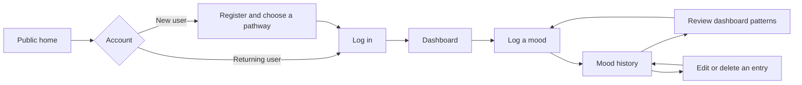
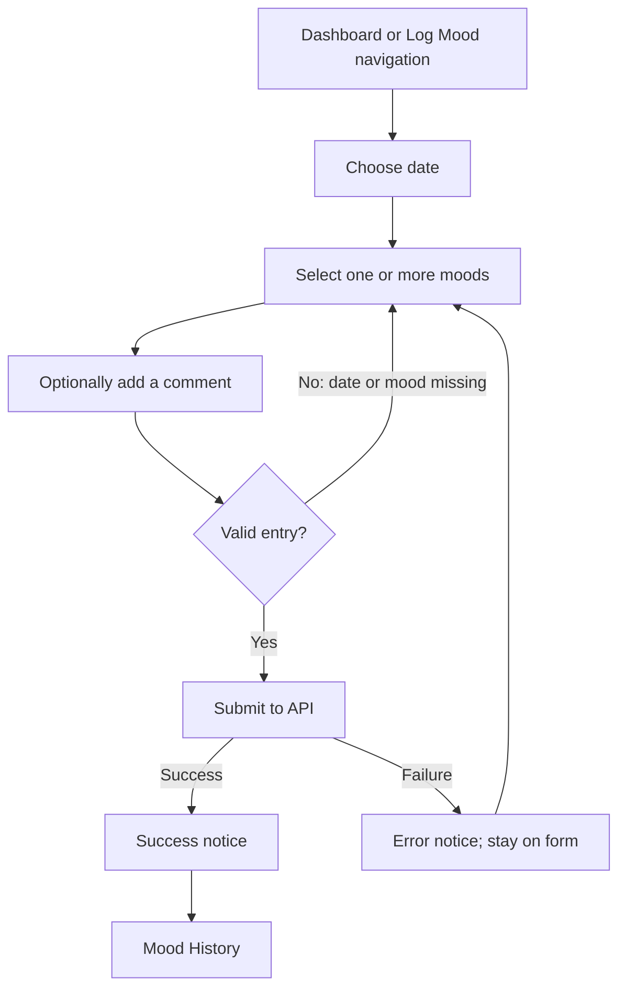

# Aura Logbook core user journeys

This map records the experience implemented in the current web app and separates it from the intended direction. It is a UX planning artifact for the Prism Garden dashboard work; it does not claim that every concept shown in the visual proposal already exists.

## Product-level path

Authenticated pages are protected: a signed-out visit to Dashboard, Log Mood, or Mood History redirects to Login. The public home CTA sends signed-out visitors to Login (registration is available in the top navigation) and signed-in users to Dashboard.

## Journey maps

### 1. First visit, account, and pathway

| Step | Current experience | Useful completion signal |
| --- | --- | --- |
| Discover | Public Home describes the product and offers “Start Your Aura Journey.” | User understands the product is for recording and exploring their own experience. |
| Create account | Register asks for email, password and confirmation, display name, birthday, and a pathway. Mindfulness is preselected; the current options are Mindfulness, Astrology & Energy, and Faith & Religion. | Validation is clear; registration success leads to Login. |
| Return | Login accepts email/password, hydrates the user session, then navigates to Dashboard. | Authenticated dashboard appears; session failure gives an error and leaves the user able to try again. |
| Personalize later | Profile card exposes Edit Profile, where pathway, aura preference, avatar, motto, and account details can be changed. | Saved preferences are reflected in the profile and theme. |

**Current boundary:** pathway selection is a profile preference and shapes optional check-in wording, daily thoughts, prompts, and interpretations. The mood-derived color itself follows recent check-ins; the pathway does not determine its hue. Current pathway labels and descriptions still need review against the inclusive experience principles before redesign copy is treated as final.

### 2. Record a mood

The form defaults the date to today, groups mood choices by their associated aura color, shows color meanings in tooltips, requires at least one mood, and makes the comment optional. It currently does **not** ask the user to select an aura color/intensity directly, provide a reflection prompt, or save a separate prompt response. Selecting a mood within a color group is not the same as recording a user-selected aura.

### 3. Review and manage mood history

| Step | Current experience | Important state or gap |
| --- | --- | --- |
| Open history | Use the authenticated sidebar’s Mood History link. | Initial list request runs when the page opens. |
| Narrow results | Choose optional start/end dates and select Filter. Future dates are disallowed; end date cannot precede start date. | No visible loading indicator is defined for filtering. |
| Read an entry | Each card shows date, mood tags, and any comment. | The current empty result is a blank list below the filters; there is no explicit first-entry invitation. |
| Edit | Choose Edit, update date/moods/comment in a modal, then save. | Success refreshes the list; failure is reported by a toast. |
| Delete | Choose Delete, confirm in a dialog, then remove the entry. | Success refreshes the list; failure is reported by a toast. Deletion is irreversible in the current UI. |

### 4. Review patterns and decide what to do next

The current Dashboard’s displayed order is:

| Priority in current screen | Content | Purpose / data source |
| --- | --- | --- |
| Orientation | Time-based greeting and profile card/sidebar | Recognize the user and expose navigation, profile editing, and Log Mood. |
| Personal context | Selected pathway card and optional zodiac insight | Show the current pathway and profile-derived zodiac content. Zodiac content is not the same as a mood-derived reflection. |
| Overview | Total entries, most frequent mood, current streak, last-entry date | Quick summary from the authenticated mood dashboard endpoints. |
| Context | Current weather card | Supporting context; current page passes a fixed Atlanta location. It can independently show loading or “Unable to load weather.” |
| Trends | Mood Breakdown and Mood Entry Timeline | Mood frequency and entry counts by date; the timeline query requests the last 7 days. |

The user’s natural next action is to log a mood, but the current Dashboard does not give that action a prominent in-content call to action. Empty data falls back to zero/“N/A” values and empty charts; Last Entry shows “No entries yet.” The whole dashboard has a shared loading state for its primary queries. Errors for summary/chart/zodiac requests do not have dedicated page-level recovery messaging in the current component.

**Not currently implemented:** a weekly aura summary, aura history/intensity visualization, prompt library, response history, or a personalized interpretation derived from the user’s past entries. These should not be shown as live or data-driven features until implemented and verified.

## Proposed pathway-module experience

This is the target experience reviewed for the next pathway design. It extends the current profile preference and should not be read as implemented behavior.

This **Core User Journey** is the source-of-truth plan for the pathway milestone and its acceptance checks. Keep the milestone description and implementation aligned with this Markdown document.

### Profile selection and navigation

- Move pathway selection into **Edit Profile → My Pathway**. For the first release, select one primary pathway at a time and configure that pathway’s modules in the same profile step.
- Keep pathway settings out of the main logbook navigation. The signed-in user opens them from Profile settings.
- Keep the existing journal destinations in the main navigation. Beneath them, show one nested module group for the active pathway, styled like the existing nested pathway navigation concept. Include only enabled modules in that group.
- Use a shared module catalog and reusable navigation/module UI. Associate catalog modules with the pathway(s) that can offer them. Reuse a common pathway-activity/insight record where the fields and lifecycle align, with explicit pathway, module, activity type, and structured content; keep sensitive or structurally distinct profile data (such as saved birth details) in its appropriate profile record.

### Shared mood logging

All pathways retain the same mood-entry experience. Add the optional multi-select question **“What’s having the biggest impact on you?”** with these context topics: Health, Fitness, Self-care, Hobbies, Identity, Spirituality, Community, Family, Friends, Partner, Dating, Task, Work, Education, Travel, Weather, Current Events, and Money. Treat these as user-recorded context, not causes of a mood.

Breathing is available in each pathway as a shared module. Its dedicated view uses an expanding/contracting visual at a comfortable 4-second inhale and 6-second exhale cadence, with a 3/3 option, pause, and reduced-motion behavior.

### Pathway modules

| Pathway | Navigation modules and page content |
| --- | --- |
| **Mindful Living** | **Mindfulness Guide**: wiki-style concepts covering present-moment awareness, non-judgmental attitudes, and starting and maintaining a routine; an optional educational overview of DBT mindfulness skills. **Practice Log**: user-recorded mindfulness practice without scores or streak pressure. Shared Breathing. |
| **Astrology & Energy** | **Daily Astrology**: one page containing the daily horoscope, optional birth-chart reading, and moon-phase mood counts with an optional reflection. Use FreeAstroAPI for daily horoscope and moon-phase data, and Astrology-API.io for chart data. Birthday can support a sun-sign reading; ask for birth time and place only for a deeper chart, and persist those details only after an explicit “Save birth details” choice. Keep provider keys server-side (`FreeAstroApi__ApiKey` and `AstrologyApi__ApiKey`). The authenticated `GET /api/astrology/birth-chart` provider adapter is gated by saved birth details and the selected Astrology & Energy pathway. Its page shows recognized planet/sign placements when present in the provider payload; actual provider-account output still needs live validation before treating field extraction as complete. Successful natal chart responses are cached in process memory for up to 30 days using a one-way hash of the birth inputs; they are not persisted to disk or the application database. The current API implementation also caches FreeAstroAPI daily readings and date-level moon phases and shares a request pacer across provider calls. **Chakra & Color Reference**: a separate wiki-like page with an actual human silhouette, seven centers, common Sanskrit and English names, body locations, color associations, and interpretive themes. Chakra descriptions, color associations, modern psychological pairings, reflection prompts, mood-association keys, and symbol asset metadata are stored as database-backed reference data rather than duplicated in the UI. An optional pattern invitation can appear after an associated mood is logged on at least three distinct days in a rolling 14-day window; it reports co-occurrence and asks the user whether the connection feels meaningful. |
| **Faith & Religion** | **Word of the Day**: a neutral, Aura-authored reflection card that does not depend on a scripture provider or selected religious framework. The user's optional written response is saved only after tapping **Save to journal** and then appears in Reflections, where it can be edited or deleted. **Sacred Texts**: show a daily reading only after the user selects a supported framework; request and show only the matching passage and reading links. The authenticated `GET /api/faith/word-of-day` and `GET /api/faith/passage?framework=...` routes provide neutral and framework-specific content separately. Christian content defaults to public-domain World English Bible text; Quran passages come from Quran.com/Quran Foundation; Jewish readings use Sefaria's daily schedule and its configured text version. The pathway UI requests the profile-selected framework only and renders its matching passage. Review licenses and required attribution before changing source or translation. API.Bible web display requires FUMS; do not configure its key until the client tracks each displayed reading. **Faith Practice Check-In**: let the user choose and revise which practices they want to track, then record “Did / Didn’t today” only for those selected practices, with an optional overall note. Save the selected keys as a private `faith-practice-preferences` pathway activity; keep daily check-ins in their separate activity type. **Faith Practice Insights**: show simple frequency/counts only for practices the user chose to track (for example, sacred-text reading, prayer or supplication, contemplation, worship or gathering, gratitude, and service or acts of care). Avoid scores, streak pressure, or claims that a practice caused a mood. Use neutral terms by default, with tradition-specific terms only when deliberately selected. Shared Breathing. |

### Pathway artwork

- Create a coordinated, individually usable set of **seven chakra illustrations** and **twelve zodiac-sign illustrations** for the Astrology & Energy pathway. The chakra set should complement the chakra wiki’s human body map and its center-specific names and color associations; the zodiac set should make each sign recognizable without depending on color alone.
- Match the existing Aura visual direction with polished, distinctive artwork rather than generic icons. Keep chakra and zodiac art pathway-specific and register every asset, intended use, and accessibility description in the asset manifest and preview contact sheet.
- The repository already contains seven chakra-symbol SVGs and shared Astrology & Energy moon/orbit/crystal artwork, but no zodiac-sign image set. Review the current chakra symbols beside the new illustrations before replacing active references; preserve the existing source assets until the replacement set is accepted and integrated.

### Interpretation and content boundaries

- In Astrology & Energy, describe moon-phase results as counts or observed co-occurrences from the user’s own entries. Do not imply that a phase caused a mood.
- In Faith & Religion, if no supported framework is selected, keep the Sacred Text area empty and hide framework-specific reading links; the neutral Word of the Day remains visible. Selecting a framework reveals only its supported passage and matching reading link. Identify the text version/source and follow its display, attribution, caching, and licensing terms.
- In the chakra reference, include familiar contemporary psychological pairings as one explicitly labeled interpretive lens: survival/fear (Root), pleasure/guilt (Sacral), willpower/shame (Solar Plexus), love/grief (Heart), truth/lies (Throat), insight/illusion (Third Eye), and cosmic or spiritual connection/attachment (Crown). Pair these with the common names and body map, but do not describe them as universal or fixed traditional teachings, or diagnose a user’s state. Mood-linked chakra suggestions remain optional invitations; the user decides whether they are meaningful.
- Across every pathway, offer optional **Resonates / Maybe / Not for me** feedback. Use feedback only to tune future suggestions of the same insight type. Offer **Save to journal** for written reflections; do not save them without an explicit action. Saved pathway reflections use the private `pathway-reflection` activity type and appear in Reflections with edit and delete controls.
- Faith practice insights summarize only the user’s own opt-in daily check-ins. Do not infer belief, commitment, or spiritual wellbeing from a missed practice; offer optional feedback on a faith insight and tune only later faith-practice insights.

### Milestone-level acceptance checks

1. Profile settings select one primary pathway and configure its modules; the navigation displays only enabled modules for that pathway under the nested pathway heading.
2. The mood logger accepts optional context topics across all pathways, and the shared breathing page visibly expands on inhale and contracts on exhale.
3. Astrology & Energy presents horoscope, birth chart, and moon-phase mood insights together; chart birth time/place remain optional and are saved only by explicit choice.
4. Mindful Living includes the wiki guide and separate practice log; Faith & Religion includes the neutral Word of the Day, a saved user-selected faith-practice list with check-in and frequency insights, and Sacred Text content/reading links gated by the selected supported framework.
5. The chakra reference uses a human silhouette and presents the seven-center terminology plus contemporary theme/challenge pairings as an optional interpretive lens.
6. Interpretive feedback is optional, non-diagnostic, and only tunes later suggestions of the same insight type. Written pathway reflections remain private and unsaved until the user taps **Save to journal**, then appear in Reflections with edit and delete controls.
7. The Astrology & Energy artwork set contains seven distinct chakra illustrations and twelve zodiac-sign illustrations, is registered in the asset manifest/contact sheet, and has been visually reviewed before any existing chakra symbols are retired.

## Cross-journey states to design for

| State | Current behavior | UX direction for the redesign |
| --- | --- | --- |
| Signed out | Protected routes redirect to Login. | Preserve the intended destination when practical; make registration easy to find. |
| Form validation | Inline messages identify invalid/missing values; API failures use toast notices. | Keep errors next to the field or action and explain how to recover. |
| Empty journal | Dashboard reports “No entries yet”; history has no explicit empty-state panel. | Offer one gentle, non-judgmental first-entry action; avoid implying the user is behind. |
| Network/service error | Weather has an inline error; mood form/history use toast notices; dashboard data errors may look like zero/empty values. | Distinguish “no data yet” from “could not load”; offer retry where appropriate. |
| Optional interpretation | Pathway and aura language appear in profile/dashboard and mood-color tooltips. | Keep core journaling usable without spiritual framing; make interpretations invitational and clearly optional. |
| Sensitive reflection | Comments are user-authored mood-entry text. | Keep ownership, privacy, and control visible; do not imply entries are public or analyzed unless true. |

## Dashboard hierarchy for the next concept

Recommended order for design exploration—not a claim about current implementation:

1. **Arrive and orient:** a warm greeting with a small, clear “Log a mood” action.
2. **Reflect now:** mood check-in and optional user-authored note; pathway language remains optional.
3. **Notice patterns:** a compact, honest summary and one legible trend visualization based only on recorded data.
4. **Supporting context:** weather and zodiac/pathway content are secondary, skippable, and never presented as causes of a mood.
5. **Return to the journal:** recent entries with a route to full history.

The next design story (#217) can turn this hierarchy into the profile-ready dashboard concept. Responsive/accessibility decisions belong to #218, and the [SwiftUI shell adaptation plan](swiftui-shell-adaptation.md) documents #219.

## Open UX questions and assumptions

- Should choosing a pathway remain part of account creation, or should users be able to skip it and select one later? The current form requires a pathway and defaults to Mindfulness.
- Should the primary check-in record the user’s aura color/intensity directly, or only the selected mood(s) and their mapped color association? These are distinct data semantics.
- What does a “current streak” mean when users can backdate entries? Confirm the rule before giving it prominent motivational weight.
- Should weather be personalized to a user-selected location, hidden, or opt-in? The current Dashboard uses Atlanta as a fixed location.
- What should be shown when one dashboard service fails while others succeed? Current loading/error behavior is inconsistent across widgets.
- What is the first-entry and no-results history experience? Both should invite without pressure.
- What language should replace current “Astrology & Energy” and “Faith & Religion” labels to match the agreed Aura, Mindfulness, and user-defined Faith/Spirituality pathways?

## Evidence and verification

This map was checked against the current route definitions, screen/components, API calls, and UI tests:

- [`router.tsx`](../../aura-ui/src/router.tsx) and [`ProtectedRoute.tsx`](../../aura-ui/src/routes/ProtectedRoute.tsx)
- [`Home.tsx`](../../aura-ui/src/pages/Home.tsx), [`Register.tsx`](../../aura-ui/src/pages/Register.tsx), and [`Login.tsx`](../../aura-ui/src/pages/Login.tsx)
- [`MoodEntryForm.tsx`](../../aura-ui/src/components/MoodEntryForm.tsx) and [`MoodEntryFormFields.tsx`](../../aura-ui/src/components/MoodEntryFormFields.tsx)
- [`MoodHistory.tsx`](../../aura-ui/src/components/history/MoodHistory.tsx) and [`MoodCard.tsx`](../../aura-ui/src/components/history/MoodCard.tsx)
- [`Dashboard.tsx`](../../aura-ui/src/pages/Dashboard.tsx), [`WeatherCard.tsx`](../../aura-ui/src/components/weather/WeatherCard.tsx), and [`moodApi.ts`](../../aura-ui/src/store/moodApi.ts)
- Focused UI tests: `aura-ui/src/pages/tests/{Dashboard,MoodEntryForm,MoodHistory,RegisterForm,LoginForm}.test.tsx` and `aura-ui/src/routes/ProtectedRoute.test.tsx`.

The tests render screens with mocked services; they confirm component behavior, not a live end-to-end session. For a live walkthrough, use a local account and verify: signed-out route protection; registration/login; one valid and one invalid mood submission; history filtering/edit/delete; zero-entry dashboard; and weather/API failure recovery. Do not use real personal journal content as test data.
