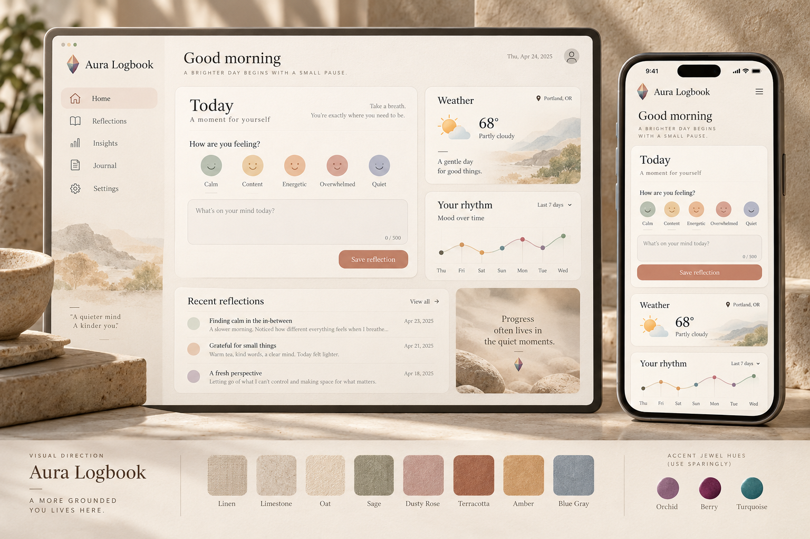

# Prism Garden visual system

Prism Garden is Aura Logbook's warm, tactile visual language. Its primary feeling is a peaceful spa: soft stone, linen, warm light, and generous breathing room. Jewel hues remain a small, personal accent—not the whole interface—and the abstract prism mark is a visual metaphor rather than a spiritual instruction. The system welcomes people using Aura/color reflection, mindfulness, or their own faith and spiritual practice.

This is a design system proposal for the web UI and future SwiftUI shell. It does not claim that the current application already implements these rules.

## Design principles

1. **Spa-like warmth and texture.** Build the atmosphere from warm neutrals, soft material cues, natural light, and whitespace—not from extra UI decoration.
2. **Jewel hues, used sparingly.** Keep berry, orchid, and turquoise to small markers, chart series, and a tiny prism emblem. Do not make large rainbow panels or oversized gemstones the visual foundation.
3. **Reflection belongs to the user.** Aura and chakra language stays optional and interpretive. Use user-selected data and clearly label suggestions; do not imply diagnosis or unseen analysis.
4. **Color is never the only signal.** Pair hue with text, shape, icon, position, or a visible label.
5. **Simple to build and carry.** Prefer design tokens, platform-native typography, and standard layout primitives over custom animation or JavaScript-driven styling.

## Core tokens

These values are starting tokens, not mood meanings. Aura colors recorded in a journal remain user data; the brand palette below is only presentation. Use dark text on colored fills unless a verified contrast pair is specified.

| Token | Value | Use |
| --- | --- | --- |
| `garden.canvas` | `#F7F2EA` | Warm parchment app background |
| `garden.surface` | `#FFFCF7` | Soft ivory cards and input surfaces |
| `garden.surfaceSoft` | `#EDE5D9` | Oat-toned grouping and quiet secondary panels |
| `garden.stone` | `#DED3C3` | Limestone and material illustration cue |
| `garden.ink` | `#352D2C` | Warm charcoal primary text and headings |
| `garden.inkMuted` | `#665D56` | Supporting text; retain readable contrast |
| `garden.line` | `#D9CEC0` | Warm neutral dividers and outlines |
| `garden.focus` | `#654A5D` | Keyboard focus ring and high-priority interaction cue |
| `garden.sage` | `#87917B` | Quiet botanical accent |
| `garden.rose` | `#C79A98` | Soft dusty-rose accent |
| `garden.terracotta` | `#C87961` | Warm action accent, used selectively |
| `garden.amber` | `#D39A4A` | Sunlit highlight; not for small text |
| `garden.blueGray` | `#91A3AC` | Cool counterpoint for weather and data |
| `prism.orchid` | `#815F7E` | Small optional jewel accent |
| `prism.berry` | `#7F263F` | Small optional jewel accent |
| `prism.turquoise` | `#2D7180` | Small optional jewel accent |

### CSS custom-property example

```css
:root {
  --garden-canvas: #f7f2ea;
  --garden-surface: #fffcf7;
  --garden-surface-soft: #ede5d9;
  --garden-stone: #ded3c3;
  --garden-ink: #352d2c;
  --garden-ink-muted: #665d56;
  --garden-line: #d9cec0;
  --garden-focus: #654a5d;
  --garden-sage: #87917b;
  --garden-rose: #c79a98;
  --garden-terracotta: #c87961;
  --garden-amber: #d39a4a;
  --garden-blue-gray: #91a3ac;

  --prism-orchid: #815f7e;
  --prism-berry: #7f263f;
  --prism-turquoise: #2d7180;

  --garden-space-1: 0.25rem;
  --garden-space-2: 0.5rem;
  --garden-space-3: 0.75rem;
  --garden-space-4: 1rem;
  --garden-space-6: 1.5rem;
  --garden-space-8: 2rem;
  --garden-radius-card: 1rem;
  --garden-radius-control: 0.625rem;
  --garden-border-width: 1px;
}
```

For SwiftUI, map the same semantic names to `Color` and `CGFloat` constants. Keep token names semantic (`canvas`, `surface`, `ink`, `focus`) rather than embedding a specific component or framework in the name.

## Type, layout, and tactile surfaces

- Pair an understated editorial serif for large page titles with the platform system sans-serif for controls, labels, and body copy. Keep journal text highly readable and respect user text scaling.
- Keep body text at a comfortable reading size (web target: 16 CSS px or larger) and line-height around 1.5. Let user text scaling work without clipping.
- Use a 4 px spacing base and the token scale above. Prefer consistent whitespace over extra borders and nested cards.
- Cards use a warm ivory surface, subtle warm border, and 16 px corner radius. Use material texture only in decorative backgrounds or illustrations—not under long text or controls. On the web, a flat color, fine border, and soft shadow are sufficient; in SwiftUI, use native materials sparingly.
- Buttons and fields use a 10 px corner radius, visible labels, and clear hover/focus/disabled states. Focus uses a 2–3 px ring with offset, not color-only fill changes.
- Keep the interface quiet and grounded. Use a tiny prism emblem or occasional faceted marker, not gem-shaped panels throughout. Avoid decorative foliage around content. Use still shapes by default; if motion is later added, honor reduced-motion settings.

## Color, data, and accessibility

- Warm stone, oat, linen, and ivory tones dominate. Use muted sage, dusty rose, terracotta, amber, and blue-gray as gentle secondary colors; jewel hues are rare accents.
- Keep charts legible and restrained. Use labeled series and direct values where practical; avoid turning the dashboard into a bright rainbow analytics wall.
- Never encode a mood, status, or action solely through hue. Include text labels and accessible names.
- Use `garden.ink` on `garden.canvas`/`garden.surface` and `garden.inkMuted` for supporting copy. Do not assume white text is readable on every prism accent; verify each foreground/background pairing before shipping.
- Preserve visible keyboard focus, semantic headings, descriptive control labels, and responsive reflow at narrow widths and enlarged text.

## Approved visual direction and representative concept

The selected direction is spa-inspired: tactile warmth and breathing room first, with jewel color as a quiet signature. The proposal below is a visual reference for composition and atmosphere, not a specification of current behavior or content. Its sample labels, mood choices, weather details, reflections, and location are illustrative placeholders and must not be treated as real product data.



Composition cues: a spacious daily reflection area is primary; weather and trend information stay secondary; recent entries remain quiet and readable. The companion phone view stacks content with native spacing. Keep any interpretation optional and user-led; never introduce fabricated personalized insights.

For responsive use, stack secondary panels after the reflection area and preserve touch targets and comfortable reading sizes. Do not squeeze a desktop layout onto the phone.

## Implementation boundary

This story defines and documents the visual system. Applying it throughout production screens, redesigning the dashboard into a profile-ready deliverable, and mapping the core journeys are follow-up work. That keeps this token system stable before individual screens adopt it.

## Reference

- [Inclusive experience principles](experience-principles.md)
- [SwiftUI shell adaptation plan](swiftui-shell-adaptation.md)
- [Current dashboard implementation](../../aura-ui/src/pages/Dashboard.tsx)
- [Current Aura palette implementation](../../aura-ui/src/theme/auraTheme.ts)
